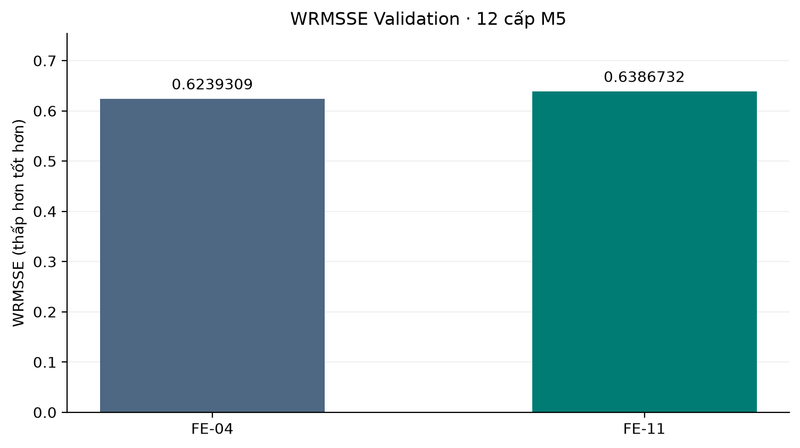
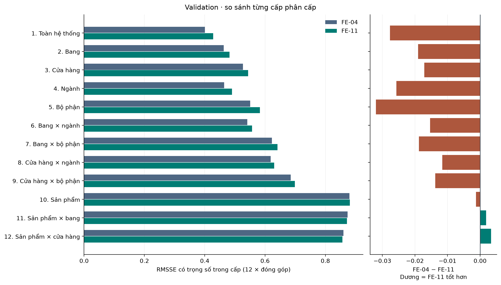
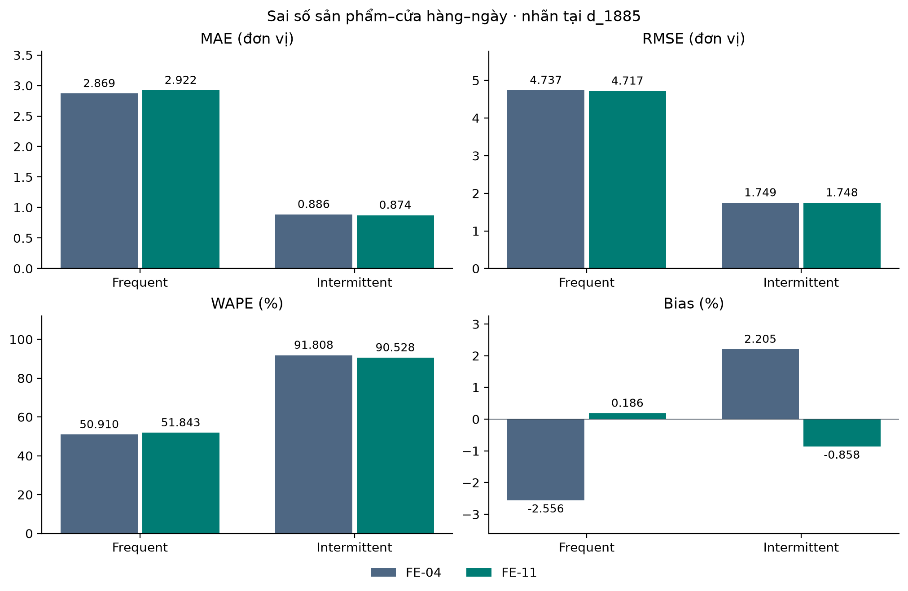
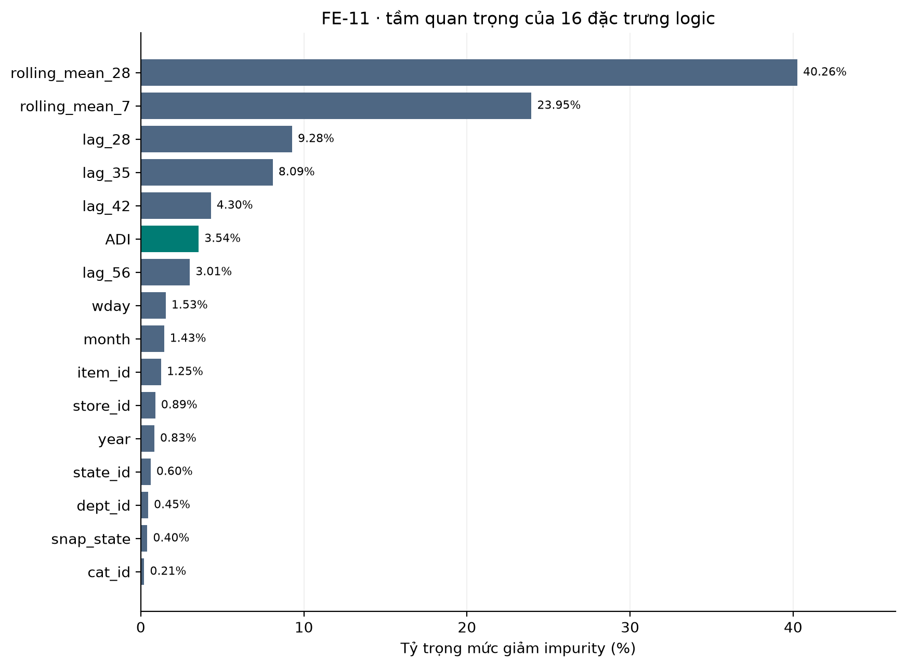

# Thực nghiệm FE-11 · thêm ADI vào RF-15 + FE-04

ADI chưa cải thiện WRMSSE Validation trong điều kiện thực nghiệm này. Đề xuất loại FE-11 và tiếp tục dùng RF-15 + FE-04.

WRMSSE FE-04 là **0,6239308540**, FE-11 là **0,6386732486**. Chênh theo chiều FE-04 trừ FE-11 là **-0,0147423946**, tương ứng **-2,3628%** của điểm FE-04.

## Thiết kế và kiểm tra lịch sử

Dùng toàn bộ 600.000 khóa Train đã niêm phong và 853.720 dòng Validation d_1886–d_1913. Cùng RF-15, 150 cây, độ sâu 20, max_features và max_samples 0,5, min_samples_leaf 5, bootstrap bật, seed 42, 8 luồng. Đã tái tạo và khớp SHA-256 của hai ma trận RF-v1, hai cột SNAP và nhãn Train với bản gốc. FE-11 nối duy nhất cột số ADI sau 3.082 cột mã hóa. WRMSSE của dự báo FE-04 đã lưu khớp lại cả 12 cấp với cùng trọng số và scale Validation.

Với ngày đích t, đặt c = t − 28. Nếu đã bán, ADI = (c − ngày bán dương đầu tiên + 1) / số ngày bán dương đến hết c. Quy ước này loại thời gian trước lần bán đầu khỏi tử số và khớp ADI trong hai tệp gốc. Nếu chưa bán thì tỷ số không xác định, mã hóa bằng 0 ở cả hai tập. Mọi ADI hữu hạn có bán đều ≥ 1, nên mã này phân biệt được bằng một cột.

Đã đối chiếu từng dòng với phép đếm độc lập bằng tìm kiếm nhị phân trên ngày bán dương. Có 128.314 dòng Train và 0 dòng Validation dùng mã 0. Cutoff của d_1000, d_1886 và d_1913 lần lượt là d_972, d_1858 và d_1885. Trong phép thử tại bốn ngày đích, thay toàn bộ lượng bán sau cutoff bằng 99 vẫn thu đúng ADI mong đợi, kể cả khi lần bán đầu rơi đúng cutoff. ADI của toàn bộ 30.490 chuỗi ở ngày đích d_1913 khớp nhãn số tại gốc d_1885 sau khi chuyển float32. Tệp gốc d_1913 chỉ dùng để xác nhận công thức. Hai nhóm dùng để phân tích sau dự báo được cố định tại d_1885. [Kết quả đối chiếu](preflight.json)

## Kết quả Validation

| Chỉ tiêu | FE-04 | FE-11 |
|---|---:|---:|
| WRMSSE 12 cấp | 0,6239308540 | 0,6386732486 |
| MAE (đơn vị) | 1,06506 | 1,05856 |
| RMSE (đơn vị) | 2,19193 | 2,18793 |
| WAPE (%) | 76,8198 | 76,3510 |
| Bias (%) | 0,4607 | -0,4750 |
| Fit (giây) | 225,05 | 453,92 |
| Dự báo (giây) | 2,77 | 5,27 |
| RAM đỉnh tiến trình RF (MiB) | 736,48 | 565,74 |

MAE và RMSE tính trên từng dòng chuỗi–ngày. WAPE = 100 × Σ|F−A| / ΣA, Bias = 100 × Σ(F−A) / ΣA. Chênh WRMSSE tương đối = 100 × (FE-04 − FE-11) / FE-04. [Bảng tổng hợp](comparison.csv)

FE-11 có điểm trong cấp thấp hơn ở **2/12 cấp**. Chênh FE-04 trừ FE-11 lớn nhất tại cấp 12 (0,00341), nhỏ nhất tại cấp 5 (-0,03199). Mỗi cấp chiếm 1/12 tổng trọng số. Bảng kèm cả điểm chuẩn hóa trong cấp và đóng góp vào WRMSSE chung. [Bảng 12 cấp](levels.csv)

## Frequent và Intermittent

| Nhóm | Cấu hình | Số chuỗi | MAE | RMSE | WAPE (%) | Bias (%) |
|---|---|---:|---:|---:|---:|---:|
| Frequent | FE-04 | 2.749 | 2,8689 | 4,7365 | 50,910 | -2,556 |
| Frequent | FE-11 | 2.749 | 2,9215 | 4,7174 | 51,843 | 0,186 |
| Intermittent | FE-04 | 27.741 | 0,8863 | 1,7486 | 91,808 | 2,205 |
| Intermittent | FE-11 | 27.741 | 0,8739 | 1,7482 | 90,528 | -0,858 |

Ở Frequent, WAPE tăng 0,933 điểm phần trăm. Bias chuyển từ -2,556% sang 0,186%, tương ứng dự báo thừa tổng lượng bán của nhóm.

Ở Intermittent, WAPE giảm 1,280 điểm phần trăm. Bias chuyển từ 2,205% sang -0,858%, tương ứng dự báo thiếu tổng lượng bán của nhóm.

Tệp nhóm cũng ghi RMSSE trung bình cấp chuỗi và Weighted RMSSE cấp 12 với trọng số chuẩn hóa trong nhóm. [Bảng theo nhóm](groups.csv)

## Giá trị bổ sung của ADI và chi phí

ADI chiếm **3,545%** tổng mức giảm impurity, đứng thứ **6/16**. Các lag chiếm 24,67% và hai rolling mean chiếm 64,21%. ADI mô tả tần suất bán trong toàn bộ lịch sử hoạt động, còn lag và rolling mean thể hiện lượng bán gần ngày dự báo. Importance mô tả cách cây dùng các đặc trưng có thể tương quan. Giá trị dự báo tăng thêm được đánh giá bằng chênh WRMSSE của hai cấu hình trên cùng cửa sổ. Một gốc Validation và một seed chỉ cho phép kết luận trong phạm vi lần so sánh này. [Bảng importance](importance.csv)

Thời gian fit tăng 101,70% so với lượt FE-04 đã lưu. Chi phí dự báo thay đổi 2,51 giây và RAM đỉnh thay đổi -170,74 MiB. Đây là hai lần chạy khác thời điểm. RAM là peak working set của tiến trình RF trên Windows, gồm cả dữ liệu và thư viện trong tiến trình. FE-11 tách chuẩn bị và chấm điểm sang tiến trình khác. Thời gian fit và dự báo chỉ đo hai thao tác tương ứng. Đỉnh riêng của tiến trình chuẩn bị là 750,12 MiB, chấm điểm và vẽ hình là 335,45 MiB. Các đỉnh riêng có thể xuất hiện ở những thời điểm khác nhau.

## Quyết định và tái lập

ADI chưa cải thiện WRMSSE Validation trong điều kiện thực nghiệm này. Đề xuất loại FE-11 và tiếp tục dùng RF-15 + FE-04. Mô hình chính thức vẫn là RF-15 + FE-04. Một lượt fit bổ sung, chỉ dự báo Validation.

Đã đối chiếu SHA-256 trước và sau trên 532 tệp dự án chính thức. Các gate, model, selected_model.json, dữ liệu, notebook, Excel, hình, báo cáo và artifact chính thức khớp bản trước thực nghiệm. Chỉ đọc byte của artifact Test để kiểm tra toàn vẹn. [Biên bản](verification.json)

Để tái lập trong checkout tương đương, đặt mã và config vào thư mục thực nghiệm mới cùng cấp rồi chạy `.venv/Scripts/python.exe -B experiments/<thư_mục_mới>/run.py` từ gốc dự án. Dấu mốc fit_started.json ngăn huấn luyện lần hai trong cùng thư mục. [Cấu hình](config.json) · [Mã huấn luyện](run.py) · [Mã báo cáo](report.py)
